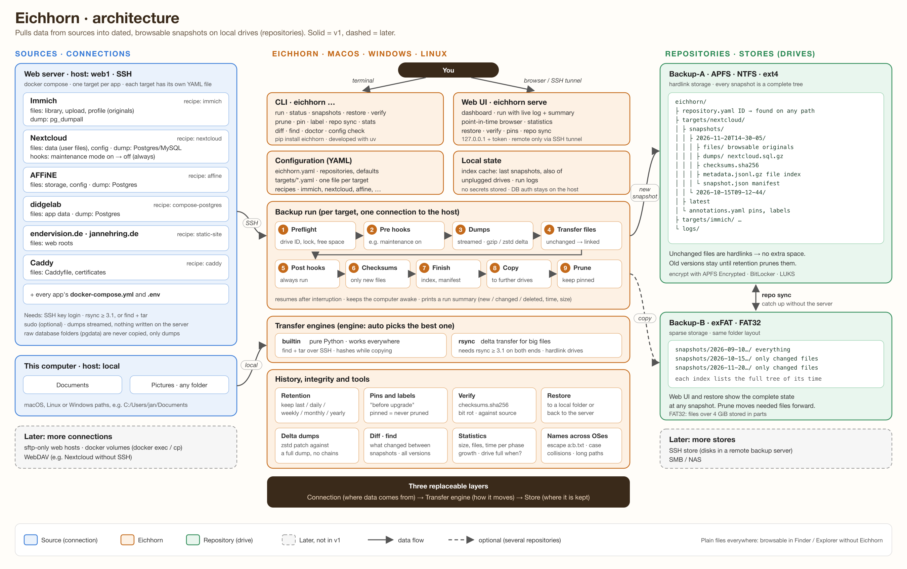
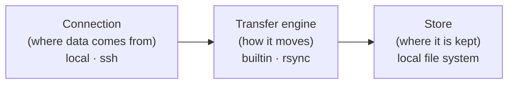

# Architecture

This page is for contributors: how the code is organised. The full design is in the
[specification](design/spec.md).



The diagram's source is [`architecture.svg`](architecture.svg). After editing it, render
the PNG again:

```bash
rsvg-convert -z 1.5 -b white docs/architecture.svg -o docs/architecture.png
```

## Three layers



Each layer is an interface with replaceable implementations, so a new kind of source or
destination is a new class, not a rewrite.

## Modules

| Module | Responsibility |
|---|---|
| `cli.py` | argparse commands, output |
| `config.py`, `schema.py`, `yamlload.py` | loading YAML with line numbers, validating against the declarative schema |
| `paths.py` | config and state folders per OS, volume discovery, Windows long paths |
| `fsinfo.py` | probing a drive: hardlinks, case sensitivity, file system name |
| `repository.py` | creating and finding repositories |
| `stores/` | the store interface and the local file system store |
| `connections/` | the connection interface; `local.py`, and `ssh.py` (OpenSSH, find/python3 listing, tar stream, `tail -c +N`) |
| `engines/builtin.py` | comparing, hardlinking, bulk and resumable copying with hashing, splitting |
| `engines/rsync.py` | rsync with `--link-dest`, then inode matching for the index |
| `dumps.py`, `hooks.py` | database dumps streamed into gzip; hook phases |
| `recipes/` | recipe templates (YAML) and their expansion and merging |
| `doctor.py` | checks of hosts, tools, sudo, folders, containers and databases |
| `excludes.py` | exclude patterns |
| `names.py` | escaping names and resolving case collisions |
| `index.py` | the file index and `checksums.sha256` |
| `run.py` | the backup run workflow |
| `summary.py`, `output.py` | run summary and terminal formatting |
| `lock.py`, `awake.py`, `cache.py` | repository lock, keep-awake, local status cache |
| `_docs.py` | generates `docs/cli.md` and `docs/configuration-reference.md` |

---

Next: [Development](development.md) · [Back to the docs index](README.md)
