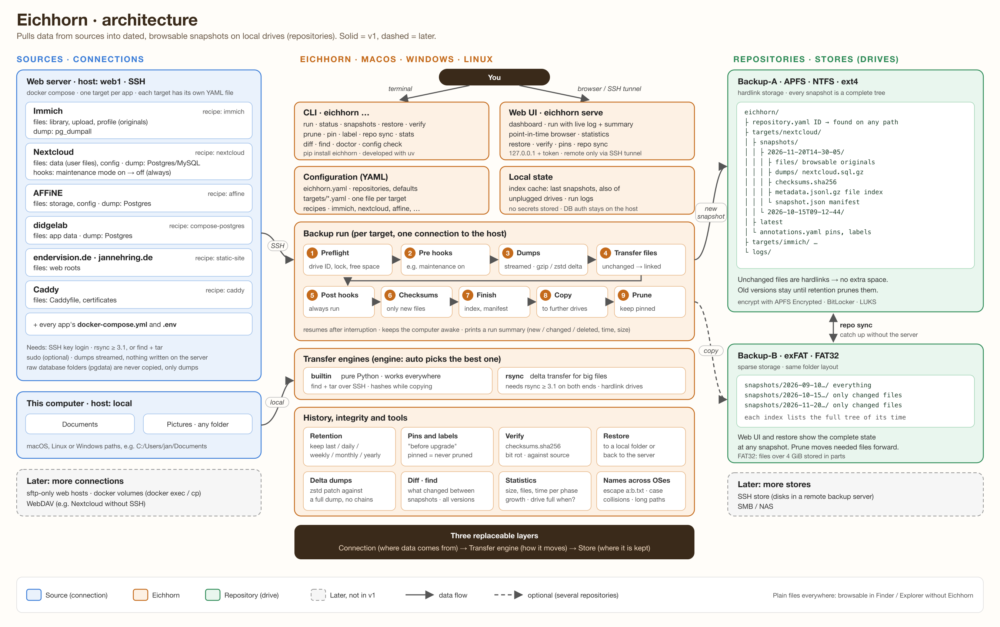

# Concepts

This page explains the few ideas Eichhorn is built on.

## Repository

A **repository** is a folder on a backup drive that holds snapshots. It contains a
`repository.yaml` with a unique ID, so Eichhorn recognises the drive under any mount
path or drive letter, and never writes to a folder that merely has the same name.

You can have several repositories, for example two drives that you swap every month.

## Target

A **target** is one thing to back up, described by its own file
`targets/<name>.yaml`: a few folders on this computer, or (from milestone 2) an app on a
server with its folders, database dumps and hooks.

## Snapshot

Each run creates a **snapshot**: a folder named after the date and time, for example
`2026-11-20T14-30-05`. It holds:

| Item | Content |
|---|---|
| `files/<source>/` | the backed-up folders, as plain files |
| `checksums.sha256` | the SHA-256 of every stored file |
| `metadata.jsonl.gz` | the file index: every file with size, time, owner and hash |
| `snapshot.json` | the manifest: status, timings, statistics, label |

A snapshot is written into a hidden `.incomplete-…` folder first and renamed only when
it is complete. If a run is interrupted, the next run continues where it stopped.

## Storage modes

| Drive | Mode | What a snapshot folder holds |
|---|---|---|
| APFS, HFS+, NTFS, ext4, btrfs, XFS | **hardlinks** | everything; unchanged files are hardlinks to the previous snapshot and take no space |
| exFAT, FAT32 | **sparse** | only new and changed files; the file index records the complete tree |

Eichhorn picks the mode when you create the repository. Both use exactly the same folder
layout.

> [!NOTE]
> On exFAT and FAT32, a snapshot folder looks incomplete in Finder or Explorer: it holds
> only what changed. The first snapshot is complete. Browsing the full state of any
> snapshot in the web interface comes with milestone 5/6.

## Engines

The **builtin** engine is pure Python and works everywhere. From milestone 2 an
**rsync** engine is used automatically where it is faster (large files that change in
place, on Linux and macOS servers).

## Change detection

A file counts as unchanged when its size and modification time are the same as in the
previous snapshot's index. Unchanged files are not read again; their checksum is taken
over from the previous snapshot.

---

Next: [Configuration](configuration.md) · [Back to the docs index](README.md)
