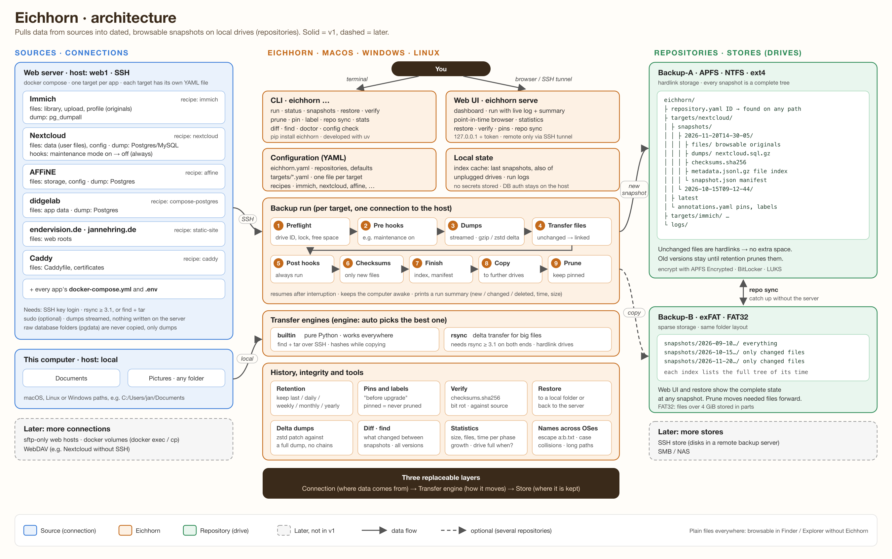

# Eichhorn: Software Specification

> *Eichhorn* (German, short for *Eichhörnchen*): squirrel. It hides its supplies
> in many places and finds them again when it needs them.

**Status:** Draft v0.6, 2026-11-20

**Changes since v0.5:**
- Published as open source on **GitHub** and **PyPI** (11.6).
- **Documentation** as Markdown in the repository, readable directly on
  GitHub (11.7).

**Changes in v0.5:**
- Renamed from Hamster to **Eichhorn**.
- **exFAT and FAT32** are supported with sparse storage. The folder layout is
  the same, and the web UI still shows the full state at any snapshot (3.8).
- Every snapshot has a complete **file index** (3.5).
- The web UI gets a **point-in-time browser** and **statistics** (9.1, 9.5).

**Changes in v0.4:**
- Database dumps can be stored as **diffs** (5.8).
- **Recipes** for the first use case's apps (4.6).
- **Pins and labels** for snapshots (7.1).
- **Run summary** (5.9).
- **Keep awake** during long runs (5.10).
- **`repo sync`** between drives (5.11).

**Changes in v0.3:**
- Installable from PyPI.
- Developed with **uv**.
- Runs on **Windows, macOS and Linux**.
- New: two transfer engines, `rsync` and `builtin`, so Eichhorn works without
  rsync.
- `latest` is now a plain file instead of a symlink.
- New: automatic discovery of repositories, safe handling of file names, and
  portable locks.

**Changes in v0.2:**
- The configuration is YAML.
- A run can write to one repository or to several.
- New: `eichhorn verify` with stored checksums.
- Reminders are removed.
- New: remote access to the web UI.

---

## 1. Purpose

Eichhorn is a command-line backup tool with a small web interface. It copies
data from **local folders** and **remote servers (over SSH)** onto **drives
attached to the machine running Eichhorn**: portable HDDs on a laptop, or disks
in a backup server. It keeps dated, browsable snapshots.

It runs on **Windows 10/11, macOS and Linux**.



The diagram's source is [`docs/architecture.svg`](../architecture.svg). To render it again:
`rsvg-convert -z 1.5 -b white docs/architecture.svg -o docs/architecture.png`.

### 1.1 Goals

- **Plain files.** A backup is an ordinary folder tree. You can browse and
  restore it with Explorer, Finder, `cp` or any file manager, without needing
  Eichhorn.
- **History.** Every run creates a new snapshot. Changed and deleted files stay
  available in older snapshots until those are pruned.
- **Space-efficient.** Unchanged files are hardlinked to the previous snapshot,
  so they take no extra space.
- **General purpose.** One tool for many *targets* (the things being backed
  up) and several *repositories* (the drives backed up to).
- **Cross-platform.** The same tool and config format on every OS. It works
  even where rsync isn't available.
- **Database-aware.** Built-in database dumps (PostgreSQL, MySQL/MariaDB,
  including inside Docker), plus hooks for things like maintenance mode.
- **Integrity.** Checksums are stored with each snapshot. They can be checked
  with Eichhorn or with standard tools such as `sha256sum -c`.
- **Safe by default.** It never writes to a drive that isn't the expected
  repository, never changes an existing snapshot, and never leaves a
  half-finished snapshot that looks complete.
- **Easy to install.** `pip install eichhorn`.

### 1.2 Non-goals (v1)

- Block-level deduplication, compression or encryption of the snapshot data.
  Encryption is the file system's job (BitLocker, APFS Encrypted, LUKS).
- Cloud storage backends (S3, B2, …).
- Unattended scheduling. Runs are started by hand, or by the user's own cron,
  launchd or Task Scheduler job calling `eichhorn run`.
- Reminders or notifications.
- Running the web UI on the public internet (see 9.4).
- Editing configs in the web UI.
- **Remote** Windows hosts over SSH. Local folders on a Windows machine that
  runs Eichhorn *are* supported.

### 1.3 First use case

A web server reached over SSH that runs, all with docker compose: Immich,
Nextcloud, AFFiNE, didgelab (Postgres), two static websites and Caddy. It is
backed up to rotating portable HDDs attached to a Mac.

---

## 2. Concepts

| Term | Meaning |
|---|---|
| **Repository** | A drive (or a folder on it) attached to the machine running Eichhorn, holding backups. It is identified by a `repository.yaml` with a unique ID, so Eichhorn recognises the drive whatever its mount path or drive letter. A user may have several repositories, e.g. two HDDs in rotation. |
| **Target** | One thing to back up: an installation such as "immich" or "nextcloud", or a local folder set such as "documents". Each target has its own config file. |
| **Host** | Where a target's data lives: `local`, or a remote Linux/Unix machine reached over SSH. |
| **Source** | A path on the host that is copied. A target has one or more sources. |
| **Engine** | How the files are transferred: `rsync` or `builtin` (section 5.2). |
| **Dump** | A database export made during the run and stored in the snapshot as a file. |
| **Hook** | A shell command run on the host before or after the copy (e.g. Nextcloud maintenance mode). |
| **Snapshot** | One complete, dated copy of a target in a repository. |
| **Run** | One execution of a backup for one or more targets into one or more repositories. |
| **Recipe** | A built-in template for a known app (e.g. `nextcloud`). It fills in a target's sources, dumps, excludes and hooks from a few parameters. |
| **Label** | A short note on a snapshot, e.g. "before Nextcloud 31 upgrade". |
| **Pin** | A mark on a snapshot so that it is never pruned. |
| **Delta dump** | A database dump stored as a patch against an earlier full dump (5.8). |

### 2.1 Architecture: three layers

Eichhorn keeps *where data comes from*, *how it is moved* and *where it is
stored* apart. Each is an interface with replaceable implementations, so new
kinds of connections or storage can be added later without changing the run
workflow, retention, verify or the web UI.

```
            run workflow · retention · verify · restore · web UI
                               │
          ┌────────────────────┼─────────────────────┐
          ▼                    ▼                     ▼
   Connection            Transfer engine          Store
   (source side)         (strategy)               (repository side)
   ─────────────         ───────────────          ─────────────────
   local      ✅ v1      builtin  ✅ v1           local filesystem ✅ v1
   ssh        ✅ v1      rsync    ✅ v1           ssh (remote disk)  later
   sftp-only  later                               smb / nas          later
   docker     later
   webdav     later
```

**Connection.** This is the source side. Its interface:
- `run(argv, stdin) → process` runs a command (for hooks and dumps)
- `list(path, excludes) → entries` lists files with type, size, mtime, mode,
  owner and symlink target
- `open_read(path, offset) → stream` reads a file from a byte offset
- `read_many(paths) → stream of (entry, data)` streams many files in bulk,
  e.g. tar over SSH
- `capabilities` says what the connection can do: shell, sudo, rsync,
  POSIX metadata

Possible later connections:
- **sftp-only:** web hosts without a shell. No hooks or dumps there, files
  only.
- **docker:** read a container's volume with `docker exec` or `docker cp`,
  even when the volume isn't mounted on the host.
- **webdav:** pull Nextcloud files over its WebDAV API, without SSH access to
  the server.

**Transfer engine.** This decides how files move from a connection into a
store, and states which connections and stores it works with:
- **builtin** works with *any* connection, using `list`, `open_read` and
  `read_many`, and with any store.
- **rsync** needs a connection with the `rsync` capability (local or ssh) and
  a local-filesystem store.

`engine: auto` picks the best engine that the connection and the store both
support.

**Store.** This is the repository side. Its interface covers:
- making a new snapshot folder
- writing a file
- hardlinking a file from the previous snapshot
- reading a file
- listing
- an atomic rename
- deleting a snapshot
- reading and writing small JSON and YAML files
- `capabilities`: hardlinks, POSIX metadata, case sensitivity, invalid names

v1 has the **local filesystem** store. A later **ssh** store could write
snapshots to a disk in a remote backup server, with Eichhorn or rsync running
there. It would keep the same plain-file layout.

**Kept out on purpose.** Object storage such as S3 doesn't fit: it has no
hardlinks, so it can't hold browsable incremental snapshots. Supporting it
would need a different storage format, and that is a non-goal (1.2).

The YAML config names the connection with `host` (`local`, an SSH host, or
later e.g. `sftp://…`, `docker://container`). The repository's store type
comes from where it is found (3.6).

---

## 3. Repository

### 3.1 Supported file systems

All repositories use **the same folder layout** (3.2). How unchanged files
are kept depends on whether the file system has hardlinks:
- **hardlinks**: every snapshot folder is a complete tree. Unchanged files are
  hardlinks, so they cost no space.
- **sparse** (without hardlinks): a snapshot folder physically holds only the
  files that were **new or changed** in that run. The full tree at that time
  is recorded in the file index (3.5), and the web UI, `restore`, `verify` and
  `repo sync` show and use the complete state (3.8).

| File system | Storage | Notes |
|---|---|---|
| APFS, HFS+ | hardlinks | Recommended on macOS: APFS (Encrypted). Case-insensitive by default, see 5.4. |
| ext4, btrfs, XFS | hardlinks | Recommended on Linux: ext4 on LUKS. |
| NTFS | hardlinks | Recommended on Windows, with BitLocker. Max 1023 hardlinks per file, see below. |
| exFAT | sparse | No owner or mode, case-insensitive, no journaling. Readable and writable on Windows, macOS and Linux. |
| FAT32 | sparse | As exFAT, plus: **max 4 GiB per file** (larger files are split, 3.8), 2-second mtime precision, and timestamps stored in local time. |

The storage mode is detected at `repo init` and saved in `repository.yaml`
(`storage: hardlinks | sparse`). On a repository with hardlinks,
`--storage sparse` can be chosen on purpose, but not the other way round.

**Hardlink limits.** NTFS allows at most 1024 links per file, and other file
systems also have limits. If creating a link fails because of the limit,
Eichhorn copies that file instead and counts it in the manifest
(`link_limit_copies`). With normal retention this never happens.

### 3.2 Layout on the drive

```
<repo root>/                          e.g. /Volumes/Backup-A/eichhorn or E:\eichhorn
  repository.yaml                     id, name, created, format version
  targets/
    immich/
      snapshots/
        2026-11-20T14-30-05/
          files/                      one folder per source, by source name
            library/2024/07/IMG_1234.jpg
            compose/docker-compose.yml
          dumps/
            immich.sql.gz             a full dump, or with delta (5.8):
                                      immich.base.sql.zst + immich.patch.zst
          checksums.sha256            see section 8
          metadata.jsonl.gz           see 3.5
          snapshot.json               manifest, see 3.4
        2026-10-15T09-12-44/
      latest                          text file holding the name of the newest snapshot
      annotations.yaml                pins and labels added later (7.1)
      .incomplete-2026-11-21T10-00-00/   only while a run is in progress
  logs/
    2026-11-20T14-30-05.log
    verify/immich/2026-11-20T14-30-05.json
  .lock                               present while a run holds the repository, see 3.7
```

- Snapshot names are local time, `YYYY-MM-DDTHH-MM-SS`. Colons are avoided so
  the names work on every file system.
- `latest` is a **plain text file**, not a symlink, because symlinks need
  special rights on Windows. It is updated atomically: write a temp file, then
  `os.replace`.
- A new snapshot is written to `.incomplete-<timestamp>/`. Only when it
  finishes successfully is it renamed to `snapshots/<timestamp>/` and
  `latest` updated. Leftover `.incomplete-*` folders from a crashed run are
  reused as the starting point of the next run, so the transfer resumes, and
  are never treated as snapshots.
- A snapshot whose required steps succeeded but where an optional step failed
  is kept and marked `status: partial` in its manifest.
- Snapshot folders are never changed after they're finished. Verify results
  go to `logs/verify/`. There is one exception: on a sparse repository,
  pruning may move still-needed files into the next kept snapshot (3.8). The
  content and the recorded tree of every kept snapshot stay the same.

### 3.3 `repository.yaml`

```yaml
id: 8f3c2a1e-5b7d-4e0a-9c61-2f4d8e9b7a10   # generated, never changes
name: Backup-A                             # human label
created: 2026-11-20T14:00:00+01:00
format: 1
filesystem: apfs                           # detected at init, informational
case_sensitive: false                      # detected at init
storage: hardlinks                         # hardlinks | sparse (3.1)
max_file_size: null                        # e.g. 4294967295 on FAT32
```

### 3.4 Snapshot manifest `snapshot.json`

This is written last, inside the snapshot.

```json
{
  "format": 1,
  "target": "immich",
  "snapshot": "2026-11-20T14-30-05",
  "status": "ok",                    // ok | partial
  "engine": "rsync",
  "started": "2026-11-20T14:30:05+01:00",
  "finished": "2026-11-20T15:02:41+01:00",
  "host": "web1",
  "copied_from": null,               // repository id when copied from another repository (5.6, 5.11)
  "label": "before Nextcloud 31 upgrade",   // from run --label, or null
  "pinned_at_creation": true,        // from run --pin
  "eichhorn_version": "0.1.0",
  "platform": "darwin",
  "storage": "hardlinks",            // hardlinks | sparse
  "resumed": 0,                      // how often this snapshot was resumed (5.7)
  "sources": [
    {"name": "library", "path": "/srv/immich/library/library", "status": "ok",
     "files": 48211, "dirs": 1290, "bytes": 312004118223,
     "transferred_bytes": 1830021445,   // bytes that went over the connection
     "stored_bytes": 1830021445,        // new data physically written to the drive
     "duration_s": 1802.5,
     "renamed": 0, "split": 0, "link_limit_copies": 0}
  ],
  "dumps": [
    {"name": "immich", "file": "dumps/immich.sql.gz", "status": "ok", "bytes": 48100221,
     "duration_s": 61.3}
  ],
  "hooks": [{"phase": "pre", "command": "…", "exit_code": 0, "duration_s": 2.0}],
  "timings": {                       // seconds per phase, for the statistics (9.5)
    "preflight": 4.1, "hooks_pre": 2.0, "dumps": 61.3, "transfer": 1802.5,
    "checksums": 95.0, "hooks_post": 1.2, "finish": 3.4,
    "copy_to_further_repos": 0, "prune": 0.8, "total": 1970.3
  },
  "repository": {"free_before": 873114992640, "free_after": 871284971195},
  "checksums": {"file": "checksums.sha256", "files": 48213, "hashed_now": 412},
  "summary": { … },                  // see 5.9
  "warnings": []
}
```

### 3.5 File index `metadata.jsonl.gz`

**Every** snapshot has a file index: a complete list of every file, folder
and symlink in the snapshot **as it was on the source**. It is the base for:
- the point-in-time browsing in the web UI (9.1)
- the statistics (9.5)
- `diff` and `find`
- restoring original names, owners and modes
- sparse storage (3.8)

It has one JSON object per line, gzipped:

```json
{"p": "files/data/jan/files/a:b.txt", "type": "file", "size": 1832, "mtime_ns": 1732101234000000000, "sha256": "3a7b…", "uid": 33, "gid": 33, "mode": 420, "here": true, "stored": "files/data/jan/files/a%3Ab.txt"}
{"p": "files/library/2024/07/IMG_1234.jpg", "type": "file", "size": 3811022, "mtime_ns": 1720000000000000000, "sha256": "9c1e…", "here": false}
{"p": "files/library/2026/11/VID_0001.mp4", "type": "file", "size": 6012331520, "sha256": "e02d…", "here": true, "parts": 2}
{"p": "files/compose/current", "type": "symlink", "target": "releases/v3"}
{"p": "files/library/2024", "type": "dir", "mode": 493}
```

| Field | Meaning |
|---|---|
| `p` | The original path, as on the source. |
| `type` | `file`, `dir` or `symlink`. |
| `size`, `mtime_ns`, `sha256` | The file's size, modification time (source time, in ns) and content hash. |
| `uid`, `gid`, `mode` | POSIX owner, group and mode from the source. |
| `here` | Whether this snapshot folder **physically holds** the file. This is always `true` with hardlink storage. With sparse storage it is `true` only for new and changed files (3.8). |
| `stored` | The name on the drive, only if it differs from `p` (escaped names, 5.4). |
| `parts` | Number of pieces, only for files split because of `max_file_size` (3.8). |
| `target` | A symlink's target. |

Rules:
- Both engines write it. The builtin engine builds it from its listing. The
  rsync engine builds it from the rsync file list and a local `stat` pass over
  the new snapshot, and takes the hashes from the checksum step.
- Change detection compares the **source** listing with the previous index
  (size and source mtime), not with timestamps on the drive. This makes it
  immune to FAT's 2-second precision and its local-time shifts at daylight
  saving changes.
- Even without Eichhorn, the file is readable with `gzip -dc` and any JSON tool.

### 3.6 Recognising and discovering a drive

- A repository counts as *connected* when a folder holds a `repository.yaml`
  with the matching ID. This keeps Eichhorn from writing to an empty
  mount-point folder on the internal disk when the drive is not plugged in.
- **Automatic discovery.** Eichhorn looks for `eichhorn/repository.yaml` at the
  top of every mounted volume, so drive letters and mount paths may change.
  The mounted volumes are:
  - Windows: drive letters `A:`–`Z:` that are ready
  - macOS: `/Volumes/*`
  - Linux: `/media/$USER/*`, `/run/media/$USER/*`, `/mnt/*`
- `paths` in the config are optional extra places to look, e.g. a repository
  in a subfolder or on a network mount.

### 3.7 Locking

- The lock is a lock file created with exclusive create (`O_EXCL`). It holds
  host name, PID, start time and the command, and works the same on every OS.
- A lock whose PID no longer runs on the same machine is stale. Eichhorn
  reports it and removes it after confirmation, or with
  `eichhorn repo unlock`.
- `verify` and `serve` (when browsing) take a shared read lock. `run` and
  `prune` take the exclusive lock.

### 3.8 Sparse storage (exFAT, FAT32)

The folder layout is exactly as in 3.2. The difference is what a snapshot
folder physically holds:

```
targets/nextcloud/snapshots/
  2026-09-10T10-00-00/files/data/jan/files/   Report.docx  Budget.xlsx  Photo.jpg   ← first run: everything
  2026-10-15T09-12-44/files/data/jan/files/   Report.docx                           ← only what changed
  2026-11-20T14-30-05/files/data/jan/files/   (nothing: Budget.xlsx was deleted, the rest unchanged)
```

Each snapshot's index (3.5) still lists the **complete** tree of its time,
with `here: false` for files that are stored in an older snapshot.

**Finding a file's content.** For a file in snapshot *T*, the content is in
the **newest snapshot at or before *T*** whose index has the same path with
`here: true` and the same `sha256`. Eichhorn builds this lookup once per
target from the indexes and caches it in the state folder.

**What uses the complete view:**
- **Web UI:** browsing any snapshot shows **all files as they were at that
  time**, not just the ones physically in that folder. Files stored in an
  older snapshot are opened and downloaded from there, and the UI shows a
  small "stored in 2026-09-10" hint.
- **`restore`** rebuilds the full state at a snapshot (or a single file or
  folder) from the right snapshots.
- **`verify`** checks every file a snapshot refers to, wherever it is stored.
- **`repo sync`** to a repository with hardlinks writes complete snapshot
  folders. To a sparse repository it writes only what changed compared with
  the destination's previous snapshot.
- **`diff` and `find`** work on the indexes, the same as with hardlinks.

**Browsing without Eichhorn.** The first snapshot is complete. Each later
folder holds the versions that were new at that time. To find an old version
of a file in Explorer or Finder, look for it in the snapshot folders from
newest to oldest. The `README.txt` that `repo init` writes into the
repository explains this in plain words.

**Pruning.** Deleting snapshot *S* may remove the only stored copy of a file
that newer snapshots still use. Before *S* is deleted:
1. Each file in *S* with `here: true` that a kept snapshot still refers to
   is **moved** to the oldest kept snapshot after *S*. A move on the same
   drive is a cheap rename.
2. In that snapshot's index the file's `here` flips to `true`, and its
   `checksums.sha256` is extended. Both files are rewritten atomically.
3. Only then is *S* deleted.

The lookup rule above stays correct, because no kept snapshot lies between
*S* and the one receiving the files. If pruning is interrupted, it is
resumed: moves are recorded in a journal (`.prune-journal`) and are safe to
repeat.

**Large files on FAT32.** A file over 4 GiB − 1 byte is stored in parts:
`VID_0001.mp4.eichhorn-part-001`, `-002`, …, and the index records `parts`.
`restore`, the web UI download and `verify` join them automatically. By hand
they can be joined with `cat VID_0001.mp4.eichhorn-part-* > VID_0001.mp4` on
macOS and Linux, or `copy /b` on Windows. exFAT has no such limit.

**Other notes:**
- Owners, modes and symlinks live only in the index, as on NTFS.
- Case collisions and invalid names are handled as in 5.4.
- exFAT and FAT32 have no journaling, so unplugging during a write can damage
  the file system. Checksums and `verify` detect this. `run --eject` ejects
  the drive safely after the run.
- The rsync engine is not used on sparse repositories, so `engine: auto`
  picks builtin there.
- Space use is the same as with hardlinks: each version of a file is stored
  once. A file that is unchanged in every run is stored only in the first
  snapshot, or in the oldest kept snapshot after pruning.

---

## 4. Configuration

### 4.1 Format and locations

All configuration is **YAML**, read with PyYAML's `safe_load`. It is checked
against a strict schema:
- Unknown keys are an error, which catches typos.
- Types are checked, so YAML's surprises (e.g. a bare `no` or `on` read as a
  boolean) cause a clear error instead of odd behaviour.
- `eichhorn config check` validates every file and prints all errors with file
  and line.

The config folder follows each OS's convention (via `platformdirs`). It can
be changed with `--config DIR` or `$EICHHORN_CONFIG`.

| OS | Config | State and logs |
|---|---|---|
| Linux | `~/.config/eichhorn/` | `~/.local/state/eichhorn/` |
| macOS | `~/Library/Application Support/eichhorn/` | `~/Library/Application Support/eichhorn/state/` |
| Windows | `%APPDATA%\eichhorn\` | `%LOCALAPPDATA%\eichhorn\` |

```
<config>/
  eichhorn.yaml                     global settings and repositories
  targets/
    immich.yaml                    one file per target; file name = target name
    nextcloud.yaml
    documents.yaml
```

A small index cache (`<state>/index.json`) remembers the last snapshot per
target and repository, so `eichhorn status` can show drives that are not
plugged in. The manifests on the drives are the source of truth;
`eichhorn repo scan` rebuilds the cache.

**Paths on Windows.** Write either `C:/Users/jan/Documents` or
`'C:\Users\jan\Documents'`. Single quotes are needed for backslashes, because
in double quotes YAML treats `\` as an escape. `eichhorn config check` warns
about double-quoted backslash paths.

### 4.2 Global config `eichhorn.yaml`

```yaml
defaults:
  retention:                  # see section 7
    keep_last: 6
    keep_monthly: 12
  checksums: true             # see section 8
  engine: auto                # auto | rsync | builtin, see 5.2
  keep_awake: true            # stop the computer from sleeping during runs, see 5.10

repositories:
  - id: 8f3c2a1e-5b7d-4e0a-9c61-2f4d8e9b7a10
    name: Backup-A
  - id: c1d9e4f2-…
    name: Backup-B
    paths: [/mnt/nas/eichhorn-b]   # optional extra location (3.6)
```

`eichhorn repo init` registers new repositories in a separate,
machine-managed file `<config>/repositories.yaml`, in the same format. That
way Eichhorn never rewrites the hand-written `eichhorn.yaml` and its comments.
Entries from both files are merged by `id`.

The web UI's address is also set in `eichhorn.yaml`:

```yaml
web:
  listen: 127.0.0.1:8765
```

### 4.3 Target config `targets/<name>.yaml`

```yaml
description: Immich photo library
host: web1                    # "local", or an SSH host (alias from ~/.ssh/config or user@host)
sudo: true                    # run transfer, dumps and hooks with sudo on the host
engine: auto                  # optional, overrides the default
repositories: [Backup-A, Backup-B]   # optional; default = all

retention:                    # optional, overrides the defaults
  keep_last: 6
  keep_monthly: 24

sources:
  - name: library             # folder name inside the snapshot's files/
    path: /srv/immich/library/library
  - name: upload
    path: /srv/immich/library/upload
  - name: compose             # docker-compose.yml, .env, other config
    path: /srv/immich
    exclude: [/library/]

dumps:
  - name: immich
    type: postgres
    container: immich_postgres   # docker container; omit for a DB running directly on the host
    database: immich
    user: postgres

hooks:
  pre:
    - docker compose -f /srv/immich/docker-compose.yml stop immich-server
  post_always:
    - docker compose -f /srv/immich/docker-compose.yml start immich-server
```

Rules:
- `name` of a source or dump: `[a-z0-9._-]+`, unique within the target.
- `path` must be absolute. `~` is expanded only for `host: local`.
- The hook phases are `pre`, `post` (only after success) and `post_always`.
  Each phase is a list of commands, run in order. For `host: local` on
  Windows, hooks run in `cmd.exe`, or in PowerShell with
  `shell: powershell` on the target.
- **Exclude patterns** use one syntax for both engines:
  - `*` matches anything except `/`
  - `**` matches anything including `/`
  - `?` matches one character, and `[abc]` matches one of a set
  - a leading `/` anchors the pattern to the source root
  - a trailing `/` matches folders only

  Other rsync filter syntax (`+`/`-` rules, `merge`) is rejected by
  `config check`, so both engines behave the same.

### 4.4 Example: Nextcloud

```yaml
description: Nextcloud
host: web1
sudo: true

sources:
  - name: data
    path: /srv/nextcloud/data
    exclude: ["/appdata_*/preview/", "*/cache/", "*/uploads/", "/updater-*/"]
  - name: compose
    path: /srv/nextcloud
    exclude: [/data/]

dumps:
  - name: nextcloud
    type: postgres            # or mysql
    container: nextcloud-db
    database: nextcloud
    user: nextcloud

hooks:
  pre:
    - docker exec -u www-data nextcloud-app php occ maintenance:mode --on
  post_always:
    - docker exec -u www-data nextcloud-app php occ maintenance:mode --off
```

### 4.5 Example: local folders on Windows

```yaml
description: Documents on this PC
host: local

sources:
  - name: documents
    path: C:/Users/jan/Documents
    exclude: [desktop.ini, Thumbs.db, "~$*"]
  - name: pictures
    path: C:/Users/jan/Pictures
```

### 4.6 Recipes

A recipe fills in a target from a few parameters, so the user doesn't need to
know each app's folders, database and maintenance commands.

```yaml
# targets/nextcloud.yaml
host: web1
sudo: true
recipe: nextcloud
with:
  compose_dir: /srv/nextcloud
  data_dir: /srv/nextcloud/data
  app_container: nextcloud-app
  db_container: nextcloud-db
  db_type: postgres
```

How recipes behave:
- A recipe produces `sources`, `dumps`, `hooks` and `exclude`. Anything also
  written in the target file is **added**: extra sources, excludes or hooks.
  A source or dump with the same `name` as a recipe one **replaces** it.
- `eichhorn target show nextcloud --expanded` prints the full result, which is
  what a run will actually do.
- `eichhorn target new NAME --recipe nextcloud` writes a file with all of the
  recipe's parameters and their defaults, commented.
- `eichhorn doctor` checks the parameters on the host: that the folders exist,
  the containers run, and the database can be reached.
- Recipes are YAML files bundled in the package (`eichhorn/recipes/*.yaml`),
  with `${param}` placeholders. A user can add their own in
  `<config>/recipes/`.

**Recipes in v1.** These cover the first use case only. The defaults follow
each app's official docker compose setup, and every parameter can be
overridden.

| Recipe | Parameters (default) | Sources | Dumps | Hooks |
|---|---|---|---|---|
| `immich` | `compose_dir`, `upload_location`, `db_container` (`immich_postgres`), `db_user` (`postgres`), `include_thumbs` (`false`), `stop_server` (`false`) | `upload_location` without `thumbs/`, `encoded-video/` (both regenerable) and `backups/` (Immich's own dumps), plus `compose_dir` | `pg_dumpall` (as the Immich docs recommend) | optional: stop and start `immich-server` |
| `nextcloud` | `compose_dir`, `data_dir`, `app_container`, `db_container`, `db_type` (`postgres` \| `mysql`), `db_name` (`nextcloud`), `db_user` (`nextcloud`), `config_dir` (optional, if not under `compose_dir`) | `data_dir` without previews, caches, upload chunks and the updater folder, plus `compose_dir` and `config_dir` | the Nextcloud database | maintenance mode on (`pre`) and off (`post_always`) |
| `affine` | `compose_dir`, `upload_location` (`~/.affine/self-host/storage`), `config_location` (`~/.affine/self-host/config`), `db_container` (`affine_postgres`), `db_name` (`affine`), `db_user` (`affine`) | upload and config folders, plus `compose_dir` | the AFFiNE database | none |
| `compose-postgres` | `compose_dir`, `db_container`, `db_name`, `db_user`, `data_dirs` (list, optional) | `compose_dir` and `data_dirs` | the database | none |
| `caddy` | `compose_dir`, `data_dir` (optional) | `compose_dir` (`Caddyfile`, compose file); `data_dir` with certificates, which Caddy can also fetch again | none | none |
| `static-site` | `path` | `path` | none | none |

Notes:
- **didgelab** uses `compose-postgres`, the generic recipe for a
  self-written app with one Postgres database.
- The **two websites** each get a target with `static-site`, or one target
  with two sources.
- The raw database data folders, e.g. Postgres' `pgdata`, are never backed up
  as files. Copying them while the database runs gives a broken copy. The
  dump is the database's backup.
- More recipes (Vaultwarden, Paperless, Gitea, …) can be added later in the
  same format.

---

## 5. Backup run

### 5.1 Steps (per target, into the first repository)

1. **Preflight.**
   - Validate the config.
   - Find the chosen repositories (3.6) and check that each is connected, has
     enough free space (warn below 10 %), and is not locked. Take the locks.
   - Pick the engine (5.2).
   - Check the SSH connection and the tools the engine needs on the host.
2. **Pre hooks** run on the host, in order. A failure aborts the target, but
   the `post_always` hooks still run.
3. **Dumps.** Each dump is streamed from the host straight into
   `dumps/<name>.sql.gz` in the snapshot, with nothing written to the server's
   disk:
   - postgres: `[docker exec <container>] pg_dump -U <user> --clean --if-exists <database>`
     (`database: "*"` means `pg_dumpall`)
   - mysql: `[docker exec <container>] mysqldump -u <user> --single-transaction --routines <database>`
   - command: a custom `run` command whose stdout is saved to `dumps/<name>.<ext>`

   The output is compressed locally and hashed while it is written: gzip, or
   zstd with a patch when `delta` is on (5.8).
   A dump that exits non-zero or produces an empty file counts as failed.
4. **Sources.** Each source is transferred with the engine into
   `.incomplete-<ts>/files/<source>/`. Unchanged files are hardlinked to the
   previous snapshot.
5. **Post hooks** (`post`, only on success) and **`post_always` hooks** (always).
6. **Checksums** (if enabled): write `checksums.sha256` (section 8).
7. **Finish.** Build the run summary (5.9). Write `metadata.jsonl.gz` and
   `snapshot.json`, `fsync`, rename to `snapshots/<ts>`, update `latest`,
   update the index cache, and release the lock. With `--pin` or `--label`,
   these go into the manifest.
8. **Further repositories:** copy the snapshot to them (5.6).
9. **Prune** according to retention (section 7), unless `--no-prune` is given.

Dumps run before sources so that the database dump and the files are as close
in time as possible while the hooks (e.g. maintenance mode) are active.

### 5.2 Transfer engines

| | `rsync` | `builtin` |
|---|---|---|
| Needs locally | rsync ≥ 3.1 | nothing (pure Python) |
| Needs on the host | rsync ≥ 3.1 | `sh`, GNU `find`, `tar` (normal on Linux); or `python3` instead of GNU find |
| Changed files | delta transfer (only the changed blocks) | whole file |
| Owner, mode, symlinks | stored natively | stored in `metadata.jsonl.gz` |
| Checksums | hashed after transfer, only new files | hashed during transfer, at no extra cost |
| Windows | only with an rsync port (cwRsync, MSYS2) | ✅ |
| Best for | servers with large files that change in place | Windows, NTFS repositories, systems without rsync |

**`engine: auto`** (the default) picks **rsync** if all of these hold:
- rsync ≥ 3.1 is installed locally
- rsync ≥ 3.1 is installed on the host
- the repository file system stores POSIX metadata (not NTFS)
- the repository uses hardlink storage (not sparse, 3.8)

Otherwise it picks **builtin**. On Windows `auto` always means builtin. The
engine used is recorded in the manifest. Both engines produce the same
snapshot layout, and either can link to a snapshot made by the other.

#### 5.2.1 rsync engine

```
rsync --archive --hard-links --acls --xattrs --numeric-ids \
      --delete --delete-excluded --partial --info=progress2,stats2 \
      --link-dest=<prev>/files/<source>/ [--rsync-path="sudo rsync"] [--exclude …] \
      [-e "ssh -o BatchMode=yes"] <host>:<path>/ <dest>/
```

- `--delete` only acts inside the new `.incomplete-*` folder.
- `--acls` and `--xattrs` are dropped automatically when the destination file
  system can't store them.
- `--numeric-ids` keeps the server's UIDs and GIDs as numbers, so a restore
  back to the server keeps the ownership.
- macOS ships an old rsync. Preflight detects it, and `auto` falls back to
  builtin with a hint to run `brew install rsync`.
- Exit code 24 (*source files vanished*) is a warning, not an error.

#### 5.2.2 builtin engine

1. **List.** Get the list of files from the host: path, type, size, mtime,
   mode, owner, group and symlink target.
   - Remote: `ssh host [sudo] find <path> -printf '…\0'`, NUL-separated, or a
     small Python helper sent over `ssh host python3 -` if GNU find is
     missing.
   - Local: `os.scandir`.
2. **Compare** with the previous snapshot's `metadata.jsonl.gz`, or with the
   files themselves if that is missing. A file is *unchanged* if path, type,
   size and mtime match.
3. **Link** unchanged files from the previous snapshot with `os.link`. If that
   fails because of the link limit, copy the file instead.
4. **Fetch** new and changed files.
   - Remote: `ssh host [sudo] tar -cf - --null -T -`, with the file list on
     stdin. Python's `tarfile` reads the stream and writes each file to the
     repository, hashing it on the way and setting its mtime.
   - Local: a buffered copy with hashing.
5. **Resume.** Files already in `.incomplete-*` from an interrupted run are
   kept if size and mtime match.

The builtin engine uses the system's OpenSSH client (built into Windows
10/11, macOS and Linux). That means `~/.ssh/config`, the SSH agent and all
keys work as usual.

### 5.3 Failure handling

| Failure | Result |
|---|---|
| Preflight fails | Nothing is written. The target is reported as failed. |
| A pre hook fails | No snapshot. `post_always` hooks run. |
| A dump fails | Snapshot is created, `status: partial`, error reported. |
| A source fails | Snapshot stays in `.incomplete-*` (resumed next time). Target failed. |
| Ctrl-C or connection loss | `post_always` hooks are attempted. The locks are released. `.incomplete-*` is kept. |
| Copy to a further repository fails | The first repository's snapshot is fine. That repository is reported as failed. |

Several targets in one run are independent. A failure in one doesn't stop
the others. The exit code is non-zero if any target or repository failed.

### 5.4 File names across operating systems

Linux servers allow file names that Windows or macOS can't store. Eichhorn
never drops or silently overwrites such a file.

- **Invalid characters or names on the repository's file system.** On NTFS
  these are:
  - the characters `< > : " \ | ? *` and control characters
  - a trailing dot or space
  - the reserved names `CON`, `PRN`, `AUX`, `NUL`, `COM1`–`COM9`, `LPT1`–`LPT9`

  The file is stored under an escaped name (`a:b.txt` → `a%3Ab.txt`). The
  original name goes into `metadata.jsonl.gz`, and the source's `renamed`
  counter is increased. `restore` writes the original name back.
- **Case collisions** on case-insensitive file systems (NTFS, and APFS by
  default): `Photo.jpg` and `photo.jpg` in one folder.
  - The builtin engine stores the second one as `photo (eichhorn-2).jpg` and
    records it in the metadata.
  - The rsync engine can't do that. On a case-insensitive repository, Eichhorn
    first checks the rsync file list for collisions. If it finds one, it stops
    that source with an error naming the files and suggesting
    `engine: builtin`.
  - `eichhorn repo init` notes when a file system is case-insensitive, and on
    macOS suggests *APFS (Case-sensitive, Encrypted)* for repositories that
    back up Linux servers.
- **Long paths on Windows.** Eichhorn uses `\\?\` extended paths internally, so
  paths over 260 characters work. `eichhorn doctor` warns if Windows'
  `LongPathsEnabled` is off, because Explorer may then fail to open such
  paths.
- **Unicode.** Names are stored as the host gives them. macOS NFD and Linux
  NFC are not normalised. A name that is not valid UTF-8 is escaped like an
  invalid character.

### 5.5 Remote prerequisites

- Key-based SSH login. Eichhorn uses the OpenSSH client and the user's SSH
  config, and never handles passwords.
- The engine's tools on the host (5.2).
- For `sudo: true`: a sudoers entry such as
  `jan ALL=(root) NOPASSWD: /usr/bin/rsync, /usr/bin/tar, /usr/bin/find, /usr/bin/docker`.
  `eichhorn doctor <target>` prints the exact line that is needed.

### 5.6 Several repositories in one run

How the repositories are chosen:
- `eichhorn run immich --repo Backup-A` writes to one repository.
  `--repo` can be given more than once.
- `eichhorn run immich --all-repos` writes to every connected repository the
  target is assigned to.
- Without either flag: if exactly one repository is connected, it is used. If
  several are connected, Eichhorn asks interactively (one of them or all of
  them). In non-interactive mode it fails and asks for `--repo` or
  `--all-repos`.

How it works:
- The host is contacted **only once**. Hooks, dumps and the transfer from the
  host go into the **first** repository. This keeps maintenance mode short
  and doesn't download the data twice.
- Each further repository then receives a **local copy** of that new
  snapshot. The copy uses the same engine logic, local to local, linking to
  the further repository's own `latest`. It goes into `.incomplete-*` and is
  renamed as usual.
- The checksum file is copied too. The files copied in this step are hashed on
  the further drive and compared with it.
- All repositories get the **same snapshot name**. Their manifests record
  `copied_from` with the first repository's ID.
- Each repository keeps its own history and retention.

### 5.7 Resuming an interrupted run

A run can be interrupted at any point: Ctrl-C, a lost connection, sleep, or a
power cut. The next `eichhorn run` of the same target into the same repository
picks up where it stopped.

| Part | How it resumes |
|---|---|
| Snapshot folder | The leftover `.incomplete-<ts>/` is reused. It keeps its original timestamp, and the manifest records `resumed: N`. |
| Files that were finished | They are kept and not transferred again. They are checked by size and mtime, plus a recorded hash for the builtin engine. |
| A large file cut off midway | **rsync:** `--partial` keeps the partial file, and the next run continues from it with delta transfer. **builtin:** files over 64 MiB are fetched one by one (not in the tar stream), and the rest is read from the byte offset where it stopped (`open_read(path, offset)`, over SSH `tail -c +N`). The whole file is then hashed and checked against the size and mtime from the listing. |
| Database dumps | They can't be resumed in the middle: a dump is a stream from the database at one moment. Unfinished dumps are deleted and made again. Finished dumps from the interrupted run are made again too, so dumps and files stay close in time. |
| Hooks | Run again (`pre` at the start, `post_always` at the end). Hooks must be safe to run twice, which maintenance mode on and off is. |
| Copy to further repositories | Each further repository has its own `.incomplete-*` and resumes the same way. |

- `eichhorn status` shows targets with an unfinished run.
- `eichhorn run --restart` throws the unfinished folder away and starts fresh.
- An unfinished folder older than 30 days (`resume_max_age`) is not resumed
  but moved aside to `.abandoned-<ts>/`. `eichhorn prune` removes those.
- Resuming never touches finished snapshots. They stay the base for
  `--link-dest` and hardlinks exactly as before.

### 5.8 Delta dumps (diffs)

Large database dumps change only a little between runs, but each snapshot
normally stores the whole dump again. With `delta`, most snapshots store only
a **patch** against an earlier full dump.

```yaml
dumps:
  - name: nextcloud
    type: postgres
    container: nextcloud-db
    database: nextcloud
    user: nextcloud
    delta:                    # optional; off by default
      full_every: 10          # a new full dump at least every 10 runs
      max_ratio: 0.5          # …or when a patch would be over 50 % of a full dump
      max_base_age: 90d       # …or when the full dump is older than this
```

**Format.** It uses standard **zstd** files, so a dump can be restored
without Eichhorn:

| File in `dumps/` | Content |
|---|---|
| `nextcloud.base.sql.zst` | The full dump this snapshot's patch refers to. It is a **hardlink** to the file in the snapshot where that full dump was made, so it costs no space. |
| `nextcloud.patch.zst` | The patch: `zstd --patch-from=<base> <new dump>`. |
| `nextcloud.sql.zst` | Used instead of the two files above in a snapshot that makes a new full dump. |

Rules:
- A patch always refers **directly to a full dump**, never to another patch,
  so there is no chain of patches. Rebuilding a dump takes one step.
- On a sparse repository (3.8) there is no hardlink: the base appears in the
  index with `here: false` and is found by the usual lookup. Pruning moves it
  forward like any other file.
- Each snapshot holds its own hardlink to its base, so **every snapshot can be
  restored on its own**. Pruning the snapshot where the full dump was made
  doesn't break anything: the base lives on as long as some snapshot links to
  it.
- `checksums.sha256` lists the stored files. The manifest also records the
  hash of the **rebuilt** dump (`rebuilt_sha256`), so `verify` can check the
  real result.

Restoring by hand:

```
zstd -d nextcloud.base.sql.zst -o base.sql
zstd -d --long=31 --patch-from=base.sql nextcloud.patch.zst -o nextcloud.sql
```

`eichhorn restore` does this itself, either to a file or straight into
`psql` or `mysql` on the host with `--into-db`.

Limits and notes:
- zstd's window caps the reference at about **2 GiB of uncompressed dump**.
  A larger dump is stored in full every time, with a warning. This limit is
  to be confirmed during implementation.
- Making a patch needs memory about the size of the uncompressed base.
- `pg_dump` and `mysqldump` sort their output in a stable order, so patches
  are small, typically 1–5 % of a full dump for a database that changes
  slowly.
- Diffs are for **dumps only** in v1. The same mechanism could later be
  offered for large source files that change in place (VM images, SQLite
  files), at the cost of those files no longer being directly browsable.
- zstd is done in Python with the `zstandard` package. CI checks that the
  output round-trips with the `zstd` command-line tool.

### 5.9 Run summary

After each target, Eichhorn prints a short summary and stores it in the
manifest (`summary`):

```
nextcloud → Backup-A  2026-11-20T14-30-05  ok  (34 min)
  data       +412 new   ~37 changed   −3 deleted   1.8 GB transferred
             most changes: jan/files/Photos/2026/11 (+398)
  compose    no changes
  dumps      nextcloud  delta patch 4.1 MB (base from 2026-10-15)
  repository +1.9 GB used, 812 GB free
```

- For each source it counts **new, changed and deleted** files with their
  sizes, and lists the top 3 folders with the most changes.
- It shows dump sizes, and for delta dumps the patch size and the date of the
  base.
- **Repository growth** is the new data actually written. Hardlinks don't
  count.
- Where the numbers come from:
  - builtin engine: the compare step
  - rsync engine: `--itemize-changes`, where `>f+++++++` is new, `>f.st…`
    changed and `*deleting` deleted
- `eichhorn run` ends with one line per target and repository.
  `eichhorn snapshots` shows the counts per snapshot.
- `--json` includes the full summary.
- The full list of changed paths is in the run log. `eichhorn diff` shows it
  for any two snapshots.

### 5.10 Keeping the computer awake

A run, `verify` or `repo sync` can take hours. While one is in progress,
Eichhorn keeps the system from going to sleep. The display may still turn off.

| OS | Method |
|---|---|
| macOS | `caffeinate -i -w <pid>`: system sleep is blocked while Eichhorn runs |
| Windows | `SetThreadExecutionState(ES_CONTINUOUS \| ES_SYSTEM_REQUIRED)` via `ctypes` |
| Linux | `systemd-inhibit --what=sleep` if available, otherwise a warning |

- It is on by default (`keep_awake: true`). `--allow-sleep` turns it off for
  one command.
- The block ends automatically when Eichhorn exits, even after a crash, because
  the methods above are tied to the process.
- It can't stop sleep when a **laptop lid is closed** (unless macOS runs in
  clamshell mode with power and an external display). If sleep happens
  anyway, the run resumes next time (5.7).

### 5.11 `repo sync`: copying between repositories

`eichhorn repo sync Backup-A Backup-B` copies snapshots that exist in
`Backup-A` but not in `Backup-B`. Two rotating drives can then catch up with
each other **without contacting any server**.

- `--target T` (can be given more than once) limits the sync to some targets.
  By default it covers every target assigned to both repositories.
- `--both` syncs in both directions.
- `--dry-run` only lists what would be copied.
- Snapshots are copied **oldest first**, keeping their names. Each one links
  against the **nearest older and nearest newer** snapshot already in the
  destination, so unchanged files become hardlinks and cost no space:
  - rsync engine: several `--link-dest` options
  - builtin engine: compared with both
- Checksums, metadata, delta-dump bases and labels are copied with the
  snapshot. Copied files are hashed on the destination and checked against
  the checksum file.
- Pins (7.1) are copied too: a snapshot pinned in the source is pinned in the
  destination.
- The manifest of a copied snapshot records `copied_from`. Snapshots that
  exist in both are never changed.
- Afterwards the destination's retention is applied as usual (unless
  `--no-prune`). A snapshot pruned in the destination isn't copied again by
  later syncs; they skip snapshots older than the destination's oldest kept
  one, unless `--include-older` is given.
- It uses the same locks, resume (5.7) and keep-awake (5.10) as `run`.

---

## 6. Command-line interface

```
eichhorn [--config DIR] [--verbose|--quiet] [--json] [--allow-sleep] <command>
```

| Command | Description |
|---|---|
| `eichhorn repo init <path> --name NAME` | Create `repository.yaml` at `<path>` and register it in `eichhorn.yaml`. Checks the file system (3.1). |
| `eichhorn repo list` | Lists repositories, whether each is connected and where, free space, and last use. |
| `eichhorn repo scan [REPO]` | Rebuild the index cache from the manifests on the drive. |
| `eichhorn repo unlock REPO` | Remove a stale lock (3.7). |
| `eichhorn repo sync SRC DST [--target T]… [--both] [--dry-run] [--no-prune] [--include-older]` | Copy missing snapshots between repositories (5.11). |
| `eichhorn target list` | Lists targets, host, engine, and the last backup per repository. |
| `eichhorn target new NAME [--recipe R]` | Create a commented template config, optionally from a recipe (4.6). |
| `eichhorn target show NAME [--expanded]` | Show a target's config. `--expanded` shows it with its recipe filled in. |
| `eichhorn recipe list` | List the recipes and their parameters. |
| `eichhorn config check` | Validate all config files. |
| `eichhorn doctor [TARGET…]` | Check SSH, the engine's tools, sudo, docker and database access on the host, plus local issues (rsync version, Windows long paths), without changing anything. |
| `eichhorn run [TARGET…\|--all] [--repo NAME]… [--all-repos] [--label TEXT] [--pin] [--dry-run] [--no-prune] [--restart] [--eject]` | Back up. `--eject` safely ejects the repository drives afterwards. `--dry-run` lists what would be transferred and skips dumps and hooks. Ends with the run summary (5.9). |
| `eichhorn status` | Overview: each target × repository, with last snapshot, age and status. |
| `eichhorn snapshots TARGET [--repo NAME]` | Lists snapshots with status, size and changed bytes. |
| `eichhorn diff TARGET [SNAP_A] [SNAP_B]` | Files added, changed or removed between two snapshots (default: the last two). |
| `eichhorn find TARGET PATTERN` | Find a file across all snapshots and show which versions exist. |
| `eichhorn restore TARGET SNAPSHOT [PATH] --to DEST` | Copy files out of a snapshot to a local folder, or with `--to host:/path` back to the server. Restores original names, owners, modes and symlinks from the metadata where the destination supports them. Never overwrites without `--force`. |
| `eichhorn verify [TARGET…\|--all] [SNAPSHOT\|--all-snapshots] [--repo NAME] [--sample PCT] [--against-source]` | Integrity check (section 8). |
| `eichhorn stats [TARGET] [SNAPSHOT] [--repo NAME]` | Statistics for a snapshot, target or repository (9.5). |
| `eichhorn prune [TARGET…] [--repo NAME] [--dry-run]` | Apply retention. Pinned snapshots are kept. |
| `eichhorn pin TARGET SNAPSHOT [--note TEXT]` / `eichhorn unpin TARGET SNAPSHOT` | Pin or unpin a snapshot (7.1). |
| `eichhorn label TARGET SNAPSHOT TEXT` | Set or remove a snapshot's label (7.1). |
| `eichhorn serve [--listen ADDR]` | Start the web interface (section 9). |

Output is human-readable with colours on a terminal, including Windows
Terminal. `--json` gives machine-readable output for `status`, `snapshots`,
`target list`, `repo list` and `verify`. Progress for a run shows the current
step, transferred bytes and speed per source.

Exit codes: `0` success, `1` a target, repository or verify check failed,
`2` usage or config error, `3` repository not connected or locked.

---

## 7. Retention and pruning

Settings per target (falling back to `defaults.retention`):

| Key | Meaning |
|---|---|
| `keep_last` | Keep the N newest snapshots. |
| `keep_daily` | Keep the newest snapshot of each of the last N days that have one. |
| `keep_weekly` | The same per ISO week. |
| `keep_monthly` | The same per month. |
| `keep_yearly` | The same per year. |

- A snapshot is kept if *any* rule keeps it.
- The newest `ok` snapshot is never pruned.
- `partial` snapshots count toward the rules like any other.
- On a sparse repository, files still needed by kept snapshots are moved
  forward before a snapshot is deleted (3.8).
- Deleting a snapshot only deletes that folder. Files hardlinked into other
  snapshots stay. On Windows, read-only attributes are cleared before
  deleting.
- Pruning works per repository. Each drive keeps its own history.
- **Pinned snapshots are never pruned** (7.1). They are kept **in addition**
  to the rules and don't use up `keep_*` slots.

### 7.1 Pins and labels

- Before an upgrade, a user can run
  `eichhorn run nextcloud --label "before Nextcloud 31 upgrade" --pin`. This
  makes a snapshot that is labelled and pinned from the start.
- Later changes:
  - `eichhorn pin TARGET SNAPSHOT [--note TEXT]` and `eichhorn unpin TARGET SNAPSHOT`
  - `eichhorn label TARGET SNAPSHOT TEXT` (an empty text removes the label)
- `latest` is accepted as `SNAPSHOT`, and `--repo` picks the repository. By
  default the command applies to every connected repository that has the
  snapshot.
- Finished snapshot folders never change. So pins and labels added later are
  stored per target in `targets/<t>/annotations.yaml`:

  ```yaml
  2026-11-20T14-30-05:
    pinned: true
    pinned_at: 2026-11-20T15:10:00+01:00
    note: keep until Nextcloud 31 runs stable
    label: before Nextcloud 31 upgrade
  ```

  The file is changed atomically (temp file + `os.replace`). An entry in
  `annotations.yaml` overrides the `label` and `pinned_at_creation` from the
  manifest.
- `eichhorn snapshots` marks pinned snapshots with 📌 and shows labels.
  `prune --dry-run` lists pinned snapshots as "kept (pinned)".
- `repo sync` (5.11) copies pins and labels.
- A pinned snapshot can only be deleted after unpinning it. Eichhorn never
  deletes it on its own.

---

## 8. Checksums and verify

### 8.1 Checksum file

When `checksums` is on (the default), each snapshot gets `checksums.sha256`.
It lists every stored file under `files/` and `dumps/`, in the standard
`sha256sum` format, with `/` as separator and UTF-8 names:

```
3a7bd3e2360a3d29eea436fcfb7e44c735d117c42d1c1835420b6b9942dd4f1b  files/library/2024/07/IMG_1234.jpg
```

This means a snapshot can be checked without Eichhorn: `sha256sum -c` on
Linux, `shasum -a 256 -c` on macOS.

Only new data is hashed, so the run stays fast:
- A file that is **hardlinked** to the previous snapshot has the same content,
  so its hash is taken over from the previous `checksums.sha256`.
- New and changed files are hashed during transfer by the builtin engine, or
  read once after the transfer by the rsync engine.
- The first snapshot of a target hashes everything once.

### 8.2 `eichhorn verify`

| Mode | What it checks |
|---|---|
| default (latest snapshot) | Re-reads every file of the snapshot and compares it with `checksums.sha256`. Reports **corrupted** (hash differs), **missing** (listed but not there) and **unexpected** (there but not listed) files. Also tests the dumps (`gzip -t`, `zstd -t`). For delta dumps it rebuilds the dump from base and patch and checks the result's hash (5.8). |
| `--all-snapshots` | The same for every snapshot of the target. Files that share an inode or file ID are hashed **once**, so the cost is about the real data on the drive, not the number of snapshots. |
| `--sample PCT` | Checks a random PCT % of the files, for a quick check of a large drive. |
| `--against-source` | Compares the latest snapshot with the host: `rsync --checksum --dry-run` (rsync engine), or `sha256sum` on the host over SSH (builtin engine). Lists the differences. Best used right after a run. |

- Results are written to `<repo>/logs/verify/<target>/<snapshot>.json` and
  printed as a summary. The snapshot itself is never changed.
- A corrupted file is never repaired automatically. The report names other
  snapshots or repositories that hold a good copy (same hash), and
  `eichhorn restore` can be used to get it from there.
- Verify can run while no backup is running. It takes the shared lock.

---

## 9. Web interface

### 9.1 Scope (v1)

`eichhorn serve` starts a small web app for the same tasks as the CLI:

- **Dashboard:** a card per target showing its last backup and age per
  repository, status, size, and the last verify result. The connected
  repositories are shown at the top.
- **Run:** start a backup for one target or all of them, to one or all
  connected repositories, optionally with a label and pin. Watch the log and
  progress live, and see the run summary at the end.
- **Snapshots:** a list per target and repository, with status, size, the
  summary counts (new, changed, deleted), label and pin. Pin or unpin and edit
  labels in place. Diff between two snapshots.
- **Repositories:** see the connected drives and start a `repo sync` between
  two of them.
- **Browse (point in time):** a file browser showing a target **exactly as
  it was at a chosen snapshot**: all files, with their original names, sizes
  and dates.
  - It works the same for every storage mode. With sparse storage (3.8),
    files that are physically stored in an older snapshot are shown and
    downloaded as if they were in this one, with a small "stored in …" hint.
  - A date picker or a timeline slider jumps to the newest snapshot at or
    before that date.
  - Download single files, or a folder as `.zip` (split files are joined).
  - "Show versions" lists the same file across all snapshots, with size, date
    and whether it changed.
  - Search by name across the whole snapshot.
  - The browser reads only the index (3.5), so it is fast even on a slow USB
    drive.
- **Statistics:** see 9.5.
- **Restore:** copy a file or folder from a snapshot to a chosen local folder.
- **Verify:** start a verify run and see its results.
- **Config:** view the target configs (read-only) and run `doctor` for a
  target.

### 9.2 Technology

- The web UI and the CLI use the same Python core, with no logic duplicated.
- Server: **FastAPI + Jinja2 templates + htmx**. Pages are rendered on the
  server, with no JavaScript build step. htmx and a small CSS file are bundled
  in the package. Live logs use Server-Sent Events.
- The web UI is an optional extra: `pip install "eichhorn[web]"`.
- Long runs are executed in a background worker inside the server process. Only
  one run per repository at a time, enforced by the same lock as the CLI.

### 9.3 Security model (v1)

The v1 web UI is meant to be used **only by the person sitting at the machine
running Eichhorn**.

- Listens on **127.0.0.1 only**. Binding to another address needs
  `--listen` explicitly and prints a warning.
- A random access token is created at start and opened in the browser with
  the URL (`http://127.0.0.1:8765/?token=…`), then kept in a cookie. This stops
  other local users or websites from triggering runs.
- POST requests need a CSRF token.
- File browsing is confined to the repository roots. Paths are resolved and
  checked against the root to prevent `..` traversal, including Windows drive
  and UNC paths.

### 9.4 Remote access and deployment

**Running Eichhorn itself on a remote backup server is supported.** The
repository drives are then the disks of that server, and it pulls from the
web servers over SSH like it does from a laptop.

**Opening the web UI on the public internet is not supported in v1.** The UI
has full power over every backup:
- it can read all files, including `.env` files and database dumps with
  passwords and personal data
- it can start runs and restores, including restores back to the servers

For that, the v1 security model (one token, no user accounts, no TLS, no
rate limiting, no audit log) is not enough.

**Supported way to reach a remote UI: an SSH tunnel.**

```
ssh -L 8765:127.0.0.1:8765 backup-server
# then open http://127.0.0.1:8765/?token=… on your laptop
```

`eichhorn serve` prints this command when it detects that it is running in an
SSH session.

**Possible later version ("public mode"), not in v1:**
- user accounts with hashed passwords, plus optional TOTP
- TLS through a reverse proxy (Caddy), with correct handling of
  `X-Forwarded-*` headers
- rate limiting on login
- roles: *viewer* (status only), *operator* (run, verify), *admin* (browse,
  download, restore)
- an audit log of every download and restore
- a setting that turns off file browsing and restore entirely

### 9.5 Statistics

All numbers come from the manifests (3.4) and indexes (3.5), so the
statistics page reads nothing else on the drive and loads quickly.

**Per snapshot** (a details page, reached from the snapshot list):

| Group | Values |
|---|---|
| Overview | status, engine, storage mode, host, label and pin, Eichhorn version, how often resumed |
| Size | logical size (all files at that time), number of files and folders, largest files (top 10) |
| Stored | new data physically written to the drive for this snapshot. For snapshots that are already done: the space pruning this snapshot would free (data used by no other snapshot) |
| Transfer | bytes transferred over the connection, average and peak speed, new / changed / deleted files and their sizes |
| Time | total duration, and the time of each phase (preflight, pre hooks, dumps, transfer, checksums, post hooks, finish, copy to further repositories, prune) as a bar |
| Per source | files, size, transferred, stored, duration, renamed and split files |
| Dumps | size per dump, duration, and for delta dumps the patch size, the ratio to a full dump, and the base date |
| Changes | top folders by new / changed / deleted files, with a link to the diff against the previous snapshot |
| Integrity | the last verify result and its date |

**Per target** (charts over all snapshots):
- logical size and number of files over time
- stored data per run, i.e. how fast the repository fills up because of this
  target
- duration and transferred bytes per run
- new / changed / deleted files per run as stacked bars, where an unusual
  spike stands out at a glance

**Per repository:**
- capacity, used and free, and the share of used space per target
- snapshots per target, oldest and newest
- an estimate of when the drive will be full, from the average stored data
  per run
- the last `repo sync` with each other repository

**Notes:**
- The charts are SVG rendered on the server, so no JavaScript library or
  build step is needed. A table under each chart shows the same numbers.
- The values that pruning would free are calculated from the indexes and
  cached per repository.
- `eichhorn stats [TARGET] [SNAPSHOT] [--json]` gives the same numbers on the
  command line.

---

## 10. Logging

- Every run writes a full log (commands, transfer stats, hook output, errors)
  to `<repo>/logs/<ts>.log` and to `<state>/logs/`.
- Eichhorn doesn't take secrets in its config. Database dumps rely on peer or
  container-local authentication, or on `.pgpass`/`.my.cnf` on the host.

---

## 11. Packaging and development

### 11.1 Installing

The PyPI distribution, the import package and the command are all
**`eichhorn`**. The name is free on PyPI, npm and Homebrew.

```
pip install eichhorn              # CLI
pip install "eichhorn[web]"       # CLI + web UI
pipx install eichhorn             # isolated, recommended for end users
uv tool install eichhorn          # the same with uv
```

A `python -m eichhorn` entry point is also provided.

### 11.2 Development with uv

The project uses **uv** for everything: Python versions, virtual environment,
dependencies, lock file, build and publish.

```
uv sync                       # create .venv, install the package and the dev group
uv run eichhorn --help         # run the CLI from the checkout
uv run pytest                 # tests
uv run ruff check . && uv run ruff format --check .
uv run mypy src
uv build                      # sdist + wheel into dist/
uv publish                    # upload to PyPI (trusted publishing from CI)
```

- `pyproject.toml` uses the **`uv_build`** build backend and a `src/` layout.
- `uv.lock` is committed.
- `requires-python = ">=3.11"`.
- Dependencies:
  - runtime: `pyyaml`, `platformdirs` and `zstandard` (delta dumps, with
    wheels for all three OSes)
  - extra `web`: `fastapi`, `uvicorn`, `jinja2`
  - dependency group `dev`: `pytest`, `ruff`, `mypy`, `types-pyyaml`
- The version comes from a single place (`src/eichhorn/__init__.py` or the
  `pyproject.toml` version), and `uv version --bump` is used for releases.

### 11.3 Layout

```
eichhorn/                        repository root
  pyproject.toml
  uv.lock
  README.md
  CHANGELOG.md  CONTRIBUTING.md  SECURITY.md  LICENSE
  .github/        workflows (ci, release), issue and PR templates
  docs/           documentation, see 11.7
  examples/       example configs, checked in CI
  src/eichhorn/
    __init__.py
    __main__.py     python -m eichhorn
    cli.py          argparse entry point
    config.py       loading YAML, schema validation into dataclasses
    paths.py        platform folders, volume discovery, Windows extended paths
    repository.py   repository init, recognition, layout
    lock.py         portable lock file
    target.py       target model
    connections/    source side (2.1)
      base.py       Connection interface + capabilities
      local.py
      ssh.py        OpenSSH subprocess, BatchMode, find/tar helpers
    stores/         repository side (2.1)
      base.py       Store interface + capabilities
      localfs.py
    engines/
      base.py       engine interface, compatibility rules, auto choice
      rsync.py
      builtin.py    listing, compare, link, tar stream, resume
    names.py        escaping invalid names, case collisions
    index.py        file index metadata.jsonl.gz (3.5), content lookup for sparse storage
    sparse.py       sparse storage: forward moves on prune, split files
    dumps.py        postgres, mysql and command dumps (streamed, gzip)
    delta.py        zstd patch-from, base hardlinks, rebuilding
    recipes/        bundled recipe YAML files + expansion
    annotations.py  pins and labels
    summary.py      run summary
    awake.py        keep-awake per OS
    sync.py         repo sync
    hooks.py
    run.py          the backup run workflow, incl. copying to further repositories
    checksums.py    incremental hashing, verify
    retention.py
    cache.py        local index cache
    web/            FastAPI app, templates, static
  tests/
```

### 11.4 Implementation rules

- Each external command is built as an argument list. No shell strings are
  built locally. Remote commands are quoted with `shlex.quote`.
- Path handling uses `pathlib` everywhere. Stored paths (manifest, metadata,
  checksums) always use `/`.
- Windows specifics:
  - `os.link` for hardlinks, file IDs instead of inodes
  - `os.replace` for atomic renames, retried a few times because antivirus
    tools can hold files briefly
  - `\\?\` extended paths
  - clearing read-only attributes before deleting
- Ctrl-C is handled on all OSes (`SIGINT`, and `CTRL_C_EVENT` on Windows), so
  the `post_always` hooks run.

### 11.5 Tests and CI

- Unit tests:
  - config
  - exclude patterns
  - retention
  - name escaping and case collisions
  - rsync command building
  - checksum reuse
- Integration tests with `host: local` and temp repositories:
  - backup, a second backup with changes, restore
  - backup to two repositories
  - a corrupted file that `verify` must find
  - both engines
- An SSH integration test against a Docker container running sshd, with
  Postgres for dumps (Linux CI only).
- **GitHub Actions matrix:** `ubuntu-latest`, `macos-latest`,
  `windows-latest` × Python 3.11, 3.12 and 3.13, using `astral-sh/setup-uv`.
  Releases are published from a tag with PyPI trusted publishing.

### 11.6 Publishing on GitHub and PyPI

Eichhorn is published as open source:
- **Source, issues and releases** are on GitHub (`github.com/jnehring/eichhorn`).
- **Packages** are on PyPI (`pip install eichhorn`).

**Repository files** (besides the code):

| File | Purpose |
|---|---|
| `README.md` | Front page on GitHub **and** PyPI: what it is, the diagram, a quick start, the features, and links to the docs. |
| `LICENSE` | MIT licence. |
| `CHANGELOG.md` | One section per version, in the [Keep a Changelog](https://keepachangelog.com) format. |
| `CONTRIBUTING.md` | How to set up with uv, run the tests and send a pull request. |
| `SECURITY.md` | How to report security problems privately, through GitHub's private vulnerability reporting. This matters because backups hold sensitive data. |
| `.github/ISSUE_TEMPLATE/` | Forms for bug reports (asking for the OS, version and `eichhorn doctor` output) and feature requests. |
| `.github/pull_request_template.md` | A checklist: tests, docs, changelog. |
| `.github/workflows/ci.yml` | lint (ruff), types (mypy), tests on the OS × Python matrix (11.5), and the docs checks (11.7). |
| `.github/workflows/release.yml` | Release from a tag, see below. |

**Versioning:**
- [Semantic Versioning](https://semver.org). It stays at `0.x` until the
  storage format is declared stable.
- The format version in `repository.yaml` and the manifests is separate from
  the package version. A change to the storage format always comes with a
  migration note in the changelog.

**Release process:**
1. Bump the version with `uv version --bump minor` (or `patch`), and move the
   "Unreleased" changelog entries under the new version.
2. Merge to `main`, then push a tag `vX.Y.Z`.
3. `release.yml` then:
   - checks that the tag matches the package version
   - runs the full CI
   - builds sdist and wheel with `uv build`
   - publishes to **PyPI** with **trusted publishing** (OIDC, no API token
     stored in GitHub), through the GitHub environment `pypi`, which needs a
     manual approval
   - creates a **GitHub Release** with the changelog section as notes and the
     built files attached
4. Before the first real release, the same workflow publishes once to
   **TestPyPI** to try the process.

**PyPI metadata** in `pyproject.toml`:
- `name`, `description`, `readme = "README.md"` and the licence as an SPDX
  expression
- `keywords` (backup, rsync, snapshot, hardlink, docker, nextcloud, immich)
- classifiers for the OSes and Python versions
- `project.urls`: Homepage, Documentation, Repository, Issues, Changelog

**Links in the README.** PyPI renders the README but can't resolve relative
links. So the README uses **absolute** GitHub URLs for links and images
(`https://github.com/jnehring/eichhorn/blob/main/docs/…`). Everywhere else in
`docs/`, relative links are used.

### 11.7 Documentation

The documentation is **Markdown in the repository**, written to be read
**directly on GitHub in the browser**. There is no site generator, no build
step and no separate hosting. Docs change in the same pull request as the
code.

**Structure:**

```
README.md                         front page: what, why, diagram, quick start, features
docs/
  README.md                       docs index, opened by GitHub when browsing docs/
  getting-started.md              install → first repository → first target → first run → browse
  installation.md                 pip / pipx / uv tool; rsync and OpenSSH on each OS
  concepts.md                     repository, target, snapshot, storage modes, engines
  configuration.md                how to write eichhorn.yaml and target files, with examples
  configuration-reference.md      every key (generated from the schema)
  cli.md                          command reference (generated, see below)
  web-ui.md                       the web interface, with screenshots
  recipes/
    README.md                     list of recipes
    immich.md  nextcloud.md  affine.md  compose-postgres.md  caddy.md  static-site.md
  guides/
    backup-docker-server.md       the full first use case, step by step
    rotating-drives.md            two drives, --all-repos, repo sync
    restore-a-file.md
    restore-an-app.md             e.g. rebuilding Nextcloud from a snapshot and its dump
    exfat-drives.md               sparse storage, what you see in Finder / Explorer
    windows.md
    remote-backup-server.md       Eichhorn on a server, web UI over an SSH tunnel
  recovery-without-eichhorn.md    how to get data back with only cp / zstd / gzip
  storage-format.md               on-disk layout, index, manifest, checksums (stable reference)
  troubleshooting.md
  faq.md
  architecture.md                 the diagram and the layers, for contributors
  architecture.svg / .png
  development.md                  uv workflow, tests, releasing
  design/spec.md                  this specification
```

**Written for GitHub's renderer:**
- Relative links between pages and to images, so they work in the browser,
  in forks and offline in a clone.
- GitHub-flavoured Markdown: tables, code blocks with a language,
  `> [!NOTE]`, `> [!WARNING]` and `> [!TIP]` callouts, and `<details>` for
  long examples.
- **Mermaid** code blocks for small flow diagrams, which GitHub renders.
  Large diagrams are SVG, with a PNG rendered from it.
- Each page starts with one sentence saying what it covers, and ends with
  "Next:" and "Back to the docs index" links. GitHub's built-in outline button
  gives each page a table of contents.
- Short pages: one topic per file.

**Kept correct by CI** (the `docs` job in `ci.yml`):
- `docs/cli.md` is generated from the CLI's argument parser
  (`uv run python -m eichhorn._docs cli`). CI regenerates it and fails if it
  differs from the committed file.
- `docs/configuration-reference.md` is generated from the config schema in
  the same way.
- Every YAML example in `docs/` and `examples/` is checked with
  `eichhorn config check`.
- A link checker (lychee) checks all relative and external links, and
  markdownlint checks the formatting.
- Web UI screenshots are refreshed by a script before each release.

**Language and tone:** English. Plain words and short sentences, with
examples before reference tables. Every command shown can be copied and run.

---

## 12. Milestones

1. **Core CLI:**
   - packaging with uv
   - config, `repo init/list`, repository discovery, lock
   - the builtin engine for local sources
   - snapshots with hardlinks, manifest, `status`, `snapshots`
   - run summary, keep awake
   - CI on all three OSes
2. **Remote and servers:**
   - SSH host, builtin remote (find + tar) and the rsync engine
   - dumps, hooks, sudo, `doctor`
   - recipes (`immich`, `nextcloud`, `affine`, `compose-postgres`, `caddy`,
     `static-site`) and the real target configs for the web server
3. **History and integrity:**
   - retention and `prune`, pins and labels
   - `diff`, `find`, `restore`
   - name escaping and metadata
   - checksums and `verify`
4. **Several repositories:**
   - `--repo` given more than once, `--all-repos`, copying a snapshot to
     further repositories
   - `repo sync`
5. **Sparse storage and delta dumps:**
   - exFAT and FAT32 (3.8): the content lookup, pruning that moves files
     forward, split files
   - delta dumps (5.8)
6. **Web UI:**
   - dashboard, runs with live log and summary
   - point-in-time browser with pins and labels
   - statistics and `eichhorn stats`
   - restore, verify, repo sync
7. **Release:**
   - full documentation (11.7)
   - TestPyPI dry run, then version 0.1.0 on PyPI and as a GitHub Release
     (11.6)

Documentation grows with each milestone. A feature counts as done only when
its docs page is written.

---

## 13. Open questions

- **Mass-deletion guard:** mark a run as suspicious, and skip pruning, when
  it deletes an unusually large share of files?
